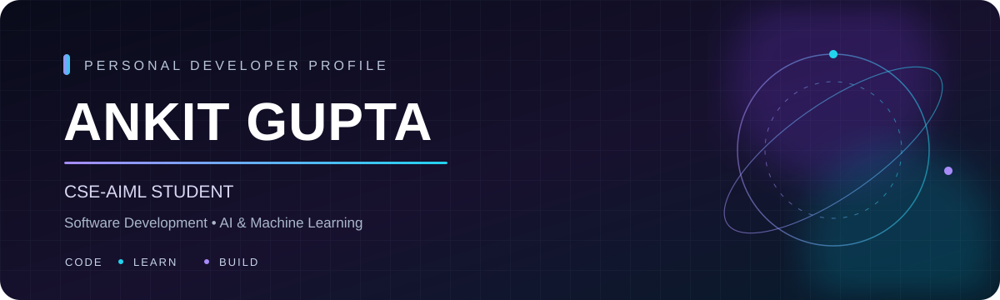
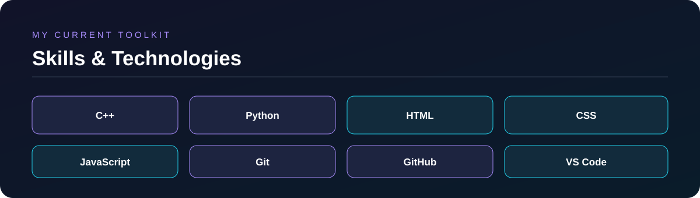
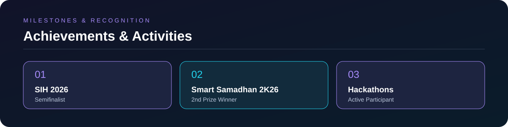
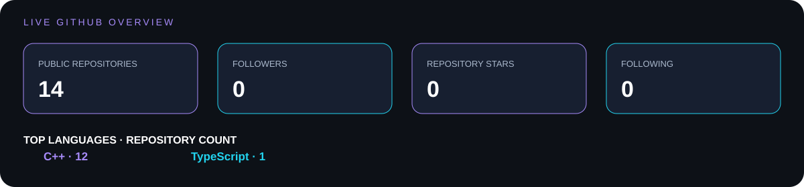
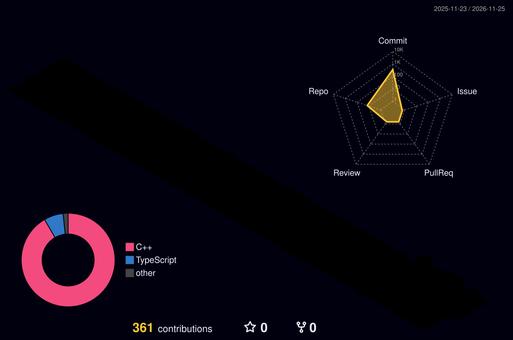



  

  

  <strong>C++ & DSA Learner | Aspiring Software Developer | Exploring AI & ML</strong>

  Building my skills through consistent learning, problem solving and projects.

  
  
  

---

<h2 align="center">Skills & Technologies</h2>

  

<h2 align="center">Achievements & Activities</h2>

  

<h2 align="center">GitHub Statistics</h2>

  

<h2 align="center">Contribution Activity</h2>

  <picture>
    <source media="(prefers-color-scheme: dark)" srcset="https://raw.githubusercontent.com/guptajiankit601-gif/guptajiankit601-gif/output/github-contribution-grid-snake-dark.svg"/>
    <source media="(prefers-color-scheme: light)" srcset="https://raw.githubusercontent.com/guptajiankit601-gif/guptajiankit601-gif/output/github-contribution-grid-snake.svg"/>
    
  </picture>

<h2 align="center">3D Contribution Graph</h2>

  

  

