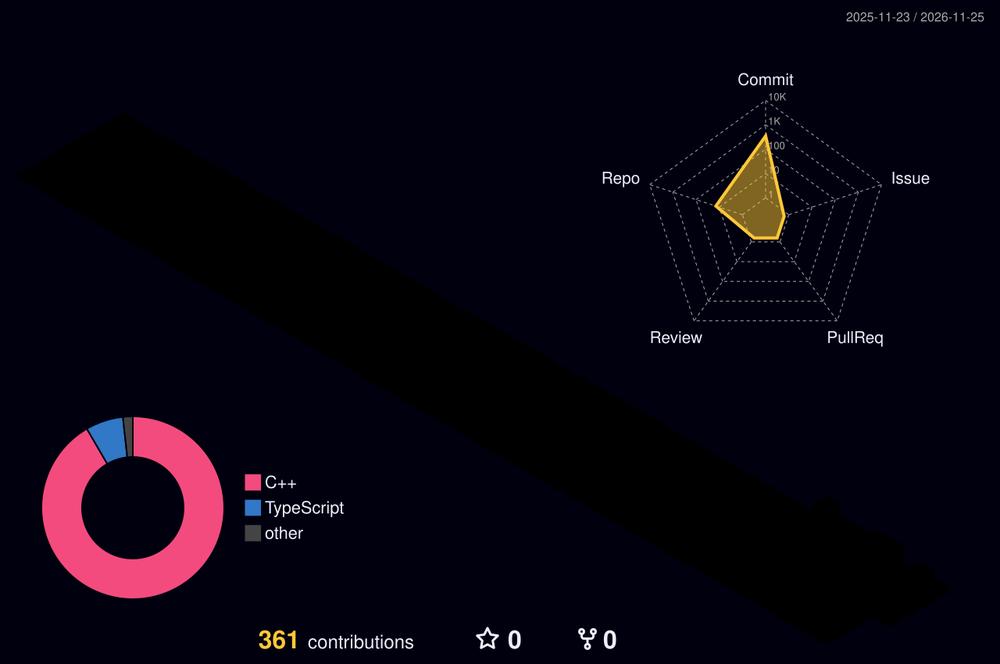

  
  

    
    
    
    
    
  

<h2 align="center">
  
  Skills &amp; Tools
</h2>

  

<h2 align="center">
  
  Contributions
  
</h2>

  
  
  

<h2 align="center">
  
  GitHub Activity
  
</h2>

  <picture>
    <source media="(prefers-color-scheme: dark)" srcset="https://raw.githubusercontent.com/guptajiankit601-gif/guptajiankit601-gif/output/github-contribution-grid-snake-dark.svg" />
    <source media="(prefers-color-scheme: light)" srcset="https://raw.githubusercontent.com/guptajiankit601-gif/guptajiankit601-gif/output/github-contribution-grid-snake.svg" />
    
  </picture>
  
  

<strong>Designed &amp; Developed with ❤️ by Ankit Gupta</strong>

  <i>Thanks for visiting — let's build something intelligent together.</i>

