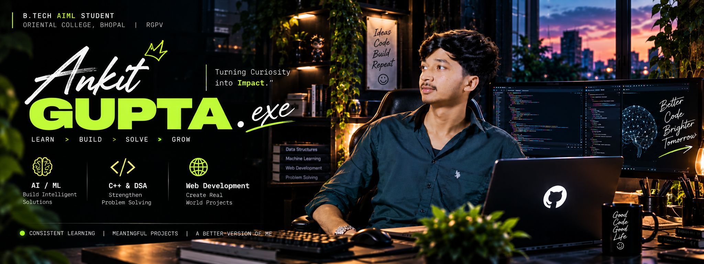

  <!-- Developer Banner -->
  

    

  # Ankit Kumar Gupta
  **B.Tech AIML Student &nbsp;|&nbsp; Aspiring Software Developer**

  

    <em>Undergraduate in Artificial Intelligence & Machine Learning focusing on C++, Data Structures & Algorithms, and robust software engineering.</em>
  

  

    
    &nbsp;
    
    &nbsp;
    
  

---

### About Me

- **Education:** B.Tech student specializing in **Artificial Intelligence & Machine Learning**.
- **Core Focus:** Building strong algorithmic thinking and problem-solving fundamentals using **C++**.
- **100–150 Days Coding Challenge:** Actively undertaking a structured daily problem-solving routine to develop discipline and code optimization skills.
- **Interests:** Systems programming concepts, Applied Machine Learning, and clean software architecture.
- **Currently Learning:** Advanced data structures (trees, graphs), time-complexity optimization, and practical ML workflows with Python.

---

### Tech Stack

| Domain | Technologies & Tools |
| :--- | :--- |
| **Languages** |    |
| **Web Development** |    |
| **Data & AI (Foundational)** |    |
| **Developer Tools** |    |

---

### Featured Repositories

- **[DSA-Journey-Cpp](https://github.com/guptajiankit601-gif/DSA-Journey-Cpp)**  
  Documenting daily Data Structures and Algorithms solutions in C++, covering foundational patterns, array manipulations, and search techniques for technical interviews.  
  `C++` &bull; `Data Structures` &bull; `Algorithms`

- **[CPP-Programming_Journey](https://github.com/guptajiankit601-gif/CPP-Programming_Journey)**  
  A structured progression through modern C++ fundamentals, memory concepts, Object-Oriented Programming (OOP), and the Standard Template Library (STL).  
  `C++` &bull; `OOP` &bull; `STL`

- **[Binary-Search-CPP](https://github.com/guptajiankit601-gif/Binary-Search-CPP)**  
  Focused problem-solving repository dissecting binary search mechanics, boundary constraints, and search-space reduction problems.  
  `C++` &bull; `Binary Search` &bull; `Problem Solving`

- **[cpp-pattern-programs](https://github.com/guptajiankit601-gif/cpp-pattern-programs)**  
  Collection of procedural pattern printing implementations in C++ reinforcing loop control and logic structuring.  
  `C++` &bull; `Loops` &bull; `Logic Building`

#### Applied Projects (In Progress)
- **Student Expense Tracker** &mdash; Responsive web application designed to help students track and categorize daily expenses. *(HTML, CSS, JavaScript &bull; Repository in staging)*
- **Varshsetu AI** &mdash; AI/ML early-warning project concept focused on precipitation and localized inundation risk prediction. *(Python, Machine Learning &bull; Prototyping)*

---

### GitHub Statistics

  

    
    &nbsp;
    
  

  

    
  

---

### Contribution Activity

  

    
  

  

    Real-time GitHub commit activity and contribution record.
  

---

### Current Goals

- [ ] Maintain daily problem-solving consistency across the 100–150 Days Coding Challenge.
- [ ] Deepen mastery of C++ STL, algorithmic complexity, and dynamic programming patterns.
- [ ] Build end-to-end applications integrating software fundamentals with AI/ML techniques.
- [ ] Prepare technical problem-solving and projects for software developer internships.

---

  

    
    &nbsp;
    
    &nbsp;
    
  

